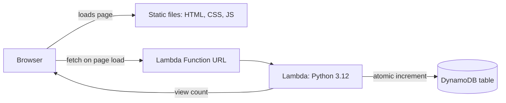

# Serverless Web Application

A small serverless web app on AWS: a static "Greeting App" page that shows how many times it has been viewed. The view count lives in DynamoDB and is updated by a Python Lambda function that the page calls over a Lambda Function URL.

## Architecture



## How it works

1. The page (`frontend/`) loads and `script.js` calls the Lambda Function URL.
2. The Lambda (`backend/lambda_function.py`) increments a `views` counter in DynamoDB with a single atomic `update_item` call and returns the new number.
3. The page shows it as "Views: N". The form on the page just greets the visitor by name in the browser.

## Repository structure

```
.
├── frontend/
│   ├── index.html
│   ├── style.css
│   └── script.js          calls the Lambda Function URL
└── backend/
    └── lambda_function.py
```

## AWS setup

| Piece | Setting |
|---|---|
| DynamoDB table | Name `DynamoDB-for-serverless-web-app`, partition key `id` (String). No starter item needed: the first call creates it |
| Lambda | Python 3.12, handler `lambda_function.lambda_handler`, optional environment variable `TABLE_NAME` |
| Lambda IAM role | Needs `dynamodb:UpdateItem` on the table (policy below) |
| Function URL | Enabled on the Lambda. Configure CORS **on the Function URL** to allow your site's origin. Do not also add CORS headers in the code, or browsers reject the duplicate headers |
| Static hosting | Serve `frontend/` from any static host, for example an S3 bucket (optionally behind CloudFront) |

Minimal IAM policy for the Lambda's role, plus the standard CloudWatch Logs permissions:

```json
{
  "Version": "2012-10-17",
  "Statement": [
    {
      "Effect": "Allow",
      "Action": "dynamodb:UpdateItem",
      "Resource": "arn:aws:dynamodb:ap-south-1:<ACCOUNT_ID>:table/DynamoDB-for-serverless-web-app"
    }
  ]
}
```

If you deploy your own copy, replace the Function URL in `frontend/script.js` with yours.

## Design notes

- **Atomic counter.** `update_item` with `ADD` avoids the read-then-write race that loses counts when two visitors arrive together, and it works on the first call without a pre-created item.
- **Least privilege.** The function only needs `UpdateItem` on one table.
- **Graceful failure.** If the API is unreachable, the page shows "Views: unavailable" instead of breaking.
- **No secrets in the frontend.** The Function URL is public by design. It contains no credentials.

## Limitations

- It counts page loads, not unique visitors.
- The Function URL has no authentication or rate limiting, so anyone can call it and inflate the count. Reserved concurrency or CloudFront and WAF in front would be next steps.
- CORS is set to whatever the Function URL allows. Restrict it to your site's origin.

## Skills demonstrated

AWS Lambda, DynamoDB, Lambda Function URLs and CORS, IAM least privilege, serverless architecture, Python (boto3), JavaScript (fetch, async/await, error handling), static site hosting.

## License

MIT, see [LICENSE](LICENSE).
